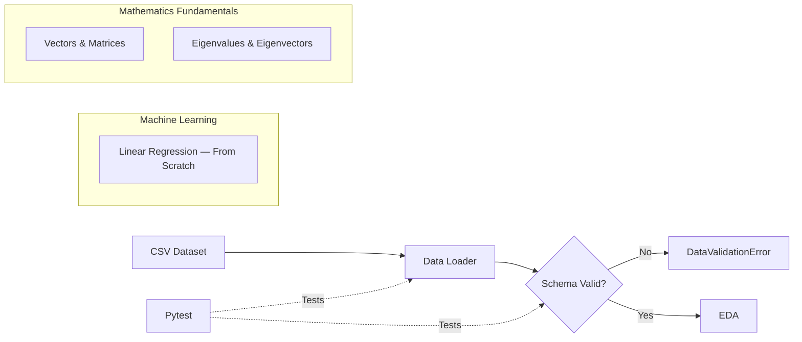

# 🧮 Machine Learning & Deep Learning — From Scratch

A collection of my Machine Learning implementations and mathematical foundations, focused on understanding **how algorithms work internally**, rather than simply using libraries.

I explore concepts through mathematical derivations, handwritten problem-solving, Python implementations, and numerical verification, progressing towards practical Machine Learning Engineering.

## 🎯 Objective

To develop strong mathematical, programming, and problem-solving foundations for Machine Learning Engineering.

My learning approach:

1. Understand the mathematics and reasoning behind each concept.
2. Implement algorithms and mathematical operations from scratch.
3. Verify solutions using NumPy or established ML libraries.
4. Test, evaluate, and document implementations.


## 📚 Projects & Progress

Click on a category to explore completed projects, implementations, and documentation.

<details>
<summary><strong>📐 Mathematics Fundamentals</strong></summary>

<br>

| Topic | Status |
|---|---|
| Vectors, Matrices & Linear Algebra | ✅ Completed exercises |
| Eigenvalues & Eigenvectors | ✅ Implemented & Verified |
| Derivatives & Chain Rule | 🔜 Planned |

📂 [Explore Mathematics Fundamentals](math-fundamentals/)

</details>

<details>
<summary><strong>🤖 Machine Learning Algorithms</strong></summary>

<br>

| Project | Status |
|---|---|
| Linear Regression — From Scratch | ✅ Completed |
| Linear Regression — Scikit-learn | ✅ Completed |
| Logistic Regression | 🔜 Planned |
| Decision Trees | 🔜 Planned |

📂 [Explore Machine Learning](machine-learning/)

</details>

<details>
<summary><strong>📊 Data Exploration</strong></summary>

<br>

| Project | Status |
|---|---|
| Titanic Dataset — Exploratory Data Analysis | ✅ Completed |

📂 [Explore Data Exploration](Data_Exploration/)

</details>

<details>
<summary><strong>🧪 Software Engineering & Testing</strong></summary>

<br>

| Project | Status |
|---|---|
| Data Loading | ✅ Implemented |
| Schema Validation | ✅ Implemented |
| Pytest Unit Tests | ✅ Implemented |

📂 [Explore Data Validation & Testing](OOP/data_Validation/)

</details>

<details>
<summary><strong>🧠 Deep Learning</strong></summary>

<br>

| Project | Status |
|---|---|
| Neural Networks from Scratch | 🔜 Planned |
| PyTorch Implementations | 🔜 Planned |

</details>

### Explore the Projects

- 📐 [Mathematics Fundamentals](math-fundamentals/) — Handwritten solutions, Python implementations, and NumPy verification.
- 🤖 [Machine Learning](machine-learning/) — ML algorithms built from scratch and compared with established libraries.
- 📊 [Data Exploration](Data_Exploration/) — Exploratory data analysis and dataset investigation.
- 🧪 [Data Validation & Testing](OOP/data_Validation/) — Data loading, schema validation, and automated testing.

Each project contains its own implementation and, where available, detailed README documentation.

## 🏗️ System Architecture



*Conceptual representation of repository components. Individual projects are not necessarily connected in one automated pipeline.*

## 🚀 Getting Started

### 1. Clone the Repository

```bash
git clone https://github.com/UUbaidd/ml-foundations-from-sratch.git
cd ml-foundations-from-sratch
```

### 2. Create a Virtual Environment

```bash
python3 -m venv .venv
```

Activate on macOS/Linux:

```bash
source .venv/bin/activate
```

Activate on Windows:

```powershell
.venv\Scripts\Activate.ps1
```

### 3. Install Dependencies

```bash
python -m pip install -r requirements.txt
```

### 4. Run Unit Tests

```bash
python -m pytest OOP/data_Validation/test_data_loader.py -v
```

Explore individual project folders for implementations, results, and documentation.

## 🛠️ Technologies

**Python · NumPy · Pandas · Matplotlib · Scikit-learn · Jupyter Notebook · Pytest**

## 🚀 Future Focus

Deep Learning, PyTorch, and advanced Machine Learning Engineering projects.

This repository is an ongoing record of my progress in building a deeper understanding of Machine Learning, from mathematical foundations to practical implementation.
